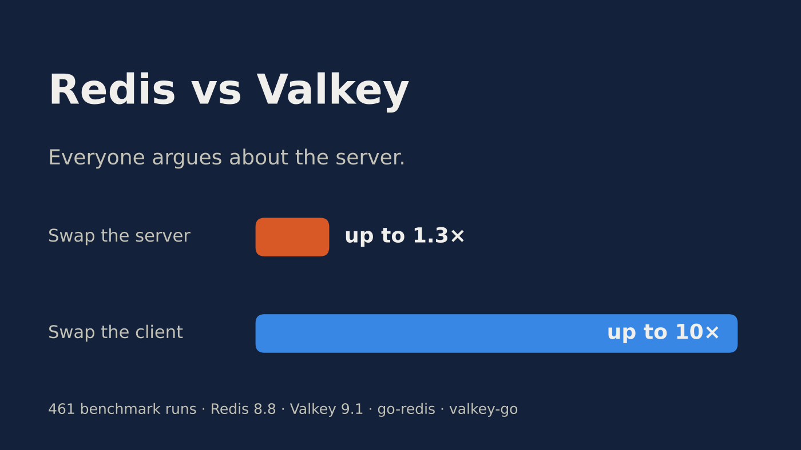
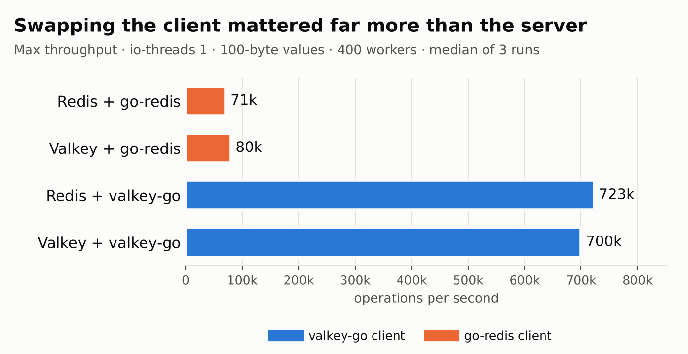
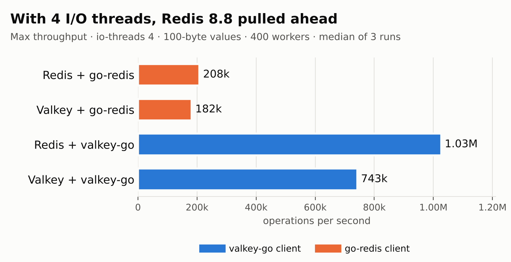
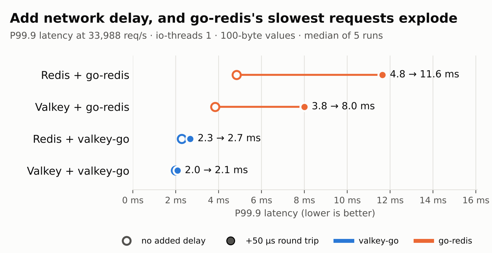
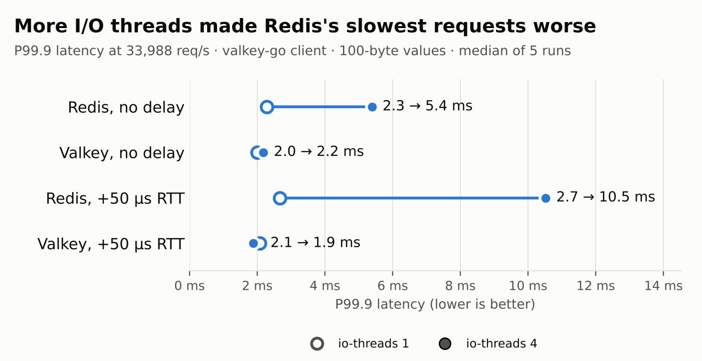
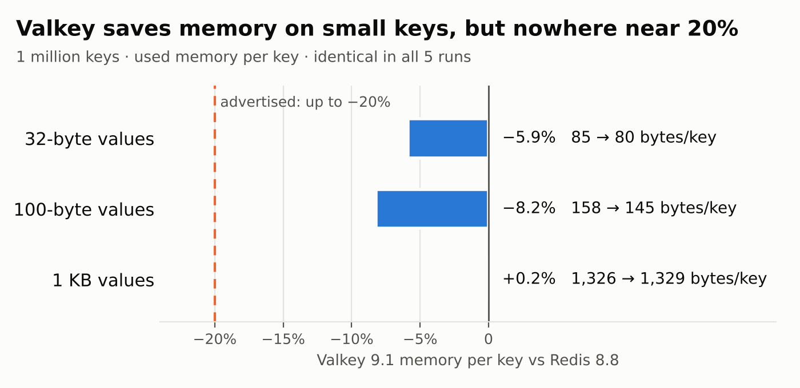
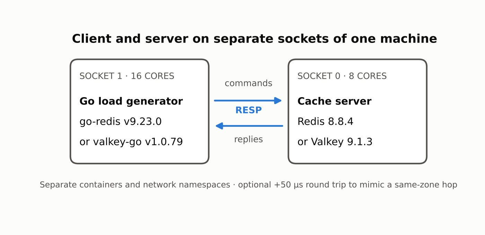

# redis-vs-valkey-bench

**Redis 8.8 vs Valkey 9.1, and go-redis vs valkey-go: an open benchmark, with every raw result.**



Everyone compares the servers. This benchmark tests the server *and* the Go client library, in every
combination, on the same hardware with the same config. In my runs, the client library made a much
bigger difference than the server.

This repo has the load generator, the scripts that run the full matrix, the analysis script, and all
461 raw results from the published run, so you can check every number or run it on your own hardware.

> Companion to the Medium article: **[link to the article]**

---

## Results at a glance

Run on 2026-11-11. Redis 8.8.4, Valkey 9.1.3, go-redis v9.23.0, valkey-go v1.0.79.
Full write-up: [`data/2026-11-11/SUMMARY.md`](data/2026-11-11/SUMMARY.md).

| # | Question | What I found |
|---|---|---|
| 1 | Do Redis and Valkey perform the same when configured identically? | **Close with 1 I/O thread (within ~14%). With 4 I/O threads, Redis 8.8 led by 13–33%.** |
| 2 | Does `io-threads 4` help? | **Big throughput gain with go-redis (+128–194%), little with valkey-go. Made Redis's tail latency worse with valkey-go.** |
| 3 | Does the client library matter more than the server? | **Yes. valkey-go delivered 3.2–10× the throughput of go-redis on the same server.** |
| 4 | Does Valkey use less memory per small key (it advertises up to 20%)? | **Yes, but 5.9% at 32 B and 8.2% at 100 B. No difference at 1 KB.** |











**Both client libraries ran on their default settings**, because that's what most services run.
go-redis used its default pool (10 × GOMAXPROCS = 160 connections). valkey-go automatically pipelines
concurrent commands over a few connections, with client-side caching off. A tuned go-redis (bigger pool,
manual pipelining) would narrow the client gap. Results from that are very welcome.

---

## How it measures



- **Server and client are fully separated:** on one host, they're pinned to different CPU sockets and NUMA
  nodes, in separate containers with separate network namespaces.
- **Identical server config:** no persistence, no `maxmemory`. Only `io-threads` (1 or 4) varies.
- **Workload:** 1M keys, uniform access, 80% GET / 20% SET, 100 B and 1 KB values. 5 s warmup, 30 s measured.
- **Phase A, max throughput:** 50 and 400 workers sending as fast as they can (closed loop).
- **Phase B, tail latency:** every setup gets the *same* fixed request rate, 60% of the slowest setup's
  maximum. The test is **open loop**: requests go out on a fixed schedule, and latency is measured from
  each request's *scheduled* send time. A closed-loop benchmark quietly stops sending when the server
  stalls, which hides the stall ("coordinated omission"). This one can't.
- **Two network conditions:** no added delay, and +25 µs `netem` delay on each side (about +50 µs round trip),
  standing in for a same-zone network hop.
- **Modules:** the official Redis image loads extra modules (search, JSON, Bloom, time series). The
  `redisnomod` engine runs the same image with them disabled. It was within ~3% of `redis` everywhere.
- **Repetitions and noise:** 3–5 runs per setup; medians reported. A difference counts as real only if the
  min–max ranges of the runs don't overlap. Reports mark the rest *within noise*.

Full details: [`data/2026-11-11/METHODOLOGY.md`](data/2026-11-11/METHODOLOGY.md).

## Limitations

- **One shared host, not two dedicated servers.** Other tenants caused background noise; one run stalled
  for 2.19 s. Medians absorb this, but treat P99.99 and max latency as unreliable.
- **No real network card.** `netem` adds a fixed delay with no jitter. This weakens the `io-threads`
  findings most, since I/O threads partly exist to absorb network work.
- **Library defaults only**, as above.
- **One machine, one day.** Run-to-run noise is measured; machine-to-machine variation is not.

If you can run it on two dedicated VMs or bare metal, please share your results (see below).

---

## Run it yourself

### Requirements

- Linux with Docker, Go 1.24+, Python 3 (standard library only)
- Ideally two NUMA nodes or sockets, so the client and server don't share cores or cache.
  The defaults assume a 96-vCPU, 2-socket host; change them for yours (below).
- About 4.5 hours for the full matrix

### Build and run

```bash
git clone https://github.com/At0m0verr1de/redis-vs-valkey-bench
cd redis-vs-valkey-bench

# static binary: it runs inside the client container
(cd bench && CGO_ENABLED=0 go build -o rvbench .)

docker pull redis:8.8
docker pull valkey/valkey:9.1
docker pull nicolaka/netshoot

# check your CPU layout first, then set the cores (see below)
lscpu | grep -i numa

./run-all.sh          # whole study; progress goes to run-all.log
```

Results land in `results/` (no delay) and `results-lan/` (+50 µs). Each gets `report.md` with tables,
effect sizes and ASCII charts, plus `summary_*.csv`.

### Pick cores for your machine

| Variable | Default | What it is |
|---|---|---|
| `CPUS` / `MEMS` | `0-7` / `0` | Server cores and NUMA node |
| `CLIENT_CPUS` / `CLIENT_MEMS` | `24-39` / `1` | Client cores and NUMA node: give it at least 2× the server's cores |

Put server and client on different NUMA nodes, use physical cores (leave SMT siblings idle), and keep
the server's cores on one L3 cache if you can.

### Run parts of it

```bash
./run-matrix.sh mem                                   # memory per key
./run-matrix.sh A                                     # max throughput
python3 -I analyze.py results                         # prints a suggested RATE for phase B
RATE=34000 ./run-matrix.sh B                          # tail latency at a fixed rate
DELAY_US=25 RESULTS=results-lan ./run-matrix.sh A     # same, with added network delay

# a single run by hand
bench/rvbench -mode bench -addr 127.0.0.1:6379 -client valkeygo -workers 400 -duration 30s
```

Useful overrides: `REPS`, `DURATION`, `WARMUP`, `KEYS`, `ENGINES` (`redis redisnomod valkey`),
`CLIENTS` (`goredis valkeygo`), `IO_LIST`, `SIZES`, `WORKERS_A`, `WORKERS_B`, `REDIS_IMAGE`,
`VALKEY_IMAGE`, and `MAX_LOAD` (waits for host load to drop below it before each run).

To test a tuned go-redis: `bench/rvbench -pool 400 …` sets its pool size. For valkey-go,
`-multiplex N` sets `PipelineMultiplex`.

### Load generator modes

`bench/rvbench -mode …`

- `load`: populate `key:0..N-1`
- `bench`: run the GET/SET mix and record an HdrHistogram (1 µs to 60 s, 3 significant figures). With
  `-rate > 0` it runs open loop.
- `mem`: flush, load N keys, report `used_memory` per key

Each run writes one JSON file with its config, server version and info, percentiles, errors and host load.

---

## Repository layout

| Path | Contents |
|---|---|
| `bench/` | Go load generator (`main.go`) |
| `start-server.sh` | Starts Redis or Valkey pinned to its cores, with optional netem delay |
| `run-matrix.sh` | Runs one phase (`mem`, `A`, `B`) across every combination |
| `run-all.sh` | The full study, in the order it was published |
| `rerun-noisy.sh` | Exactly which groups were re-run after host-load spikes, and how |
| `rate.py` | Picks the common phase-B rate |
| `analyze.py` | Summaries, effect sizes, noise flags, ASCII charts |
| `data/2026-11-11/` | The published run: `SUMMARY.md`, `METHODOLOGY.md`, reports, CSVs, all 461 raw JSON results, full log |
| `docs/images/` | Charts used here and in the article, plus `make_images.py` that draws them |

## Share your results

Ran it on different hardware, cloud VMs, ARM, or with tuned clients? Open a pull request adding a folder
`data/<date>-<short-description>/` with your raw results, `report.md`, and a few lines on your hardware and
any changes. Disagreements are especially welcome.

## License

MIT. See [LICENSE](LICENSE).

Redis is a trademark of Redis Ltd. Valkey is a project of the Linux Foundation. This project is
independent and not affiliated with either.
